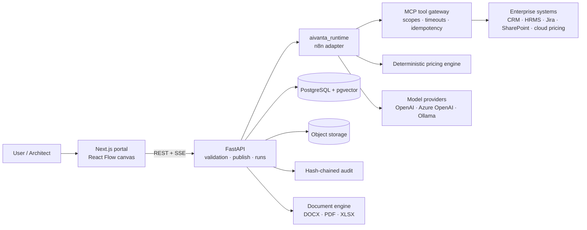

# Architecture overview — AIVANTA Relay

## Design-time vs run-time

| Design-time (browser + `canvas_graphs.draft`) | Run-time (server) |
|---|---|
| Node positions, connections, node configuration | Immutable `graph_versions` with content hash |
| Live edge checks (`edgeProblem`) | Full validation as a publish gate |
| Save draft, compare versions | Compile with the runtime adapter, then execute in the API process or a worker |
| Nothing executes from browser-provided code | `execution_runs` state, events, outputs and approvals are persisted separately |

## Request flow for a run

1. `POST /api/runs` snapshots the published version into `execution_runs.graph_snapshot` and dispatches `start`. Dispatch is inline as a background task, or through `pending_action` for the worker.
2. `run_service.build_context` creates a `RunContext`. It holds the tenant-scoped project, approved tools, the pricing, cloud and retrieval hooks, the LLM settings, the cancellation check and the state store.
3. The adapter emits typed events (`node_started`, `route_selected`, `approval_requested`, …). The API persists them to `run_events`, updates `node_status` and creates `approvals` rows.
4. The adapter returns a `RunOutcome`. The API then stores the outputs, upserts versioned `artifacts` and writes an audit record.
5. `POST /api/approvals/{id}/decide` checks the role and segregation of duties, then dispatches `resume`.
6. `POST /api/runs/{id}/retry` dispatches `retry`, which resumes from the last checkpoint.

## Packages

| Package | Responsibility |
|---|---|
| `aivanta_graph` | canvas.v1 models, validation rules, workflow templates, structural diff |
| `aivanta_templates` | agent template YAML, typed output models, guardrail prompt, mock generators |
| `aivanta_pricing` | Decimal pricing engine, scenarios, policy flags, cloud cost model |
| `aivanta_docs` | artifact → document mapping and DOCX/PDF/XLSX renderers |
| `aivanta_connectors` | MCP gateway, tool registry, ingestion (scan, redaction, extraction), retrieval |
| `aivanta_runtime` | shared contract, executors and prompts, plus the edition's adapter |
| `aivanta_api` | HTTP API, persistence, auth/RBAC, tenancy, run service, worker |
